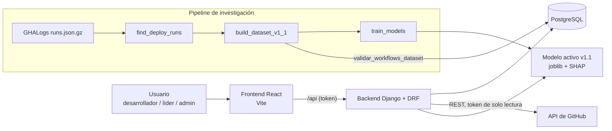
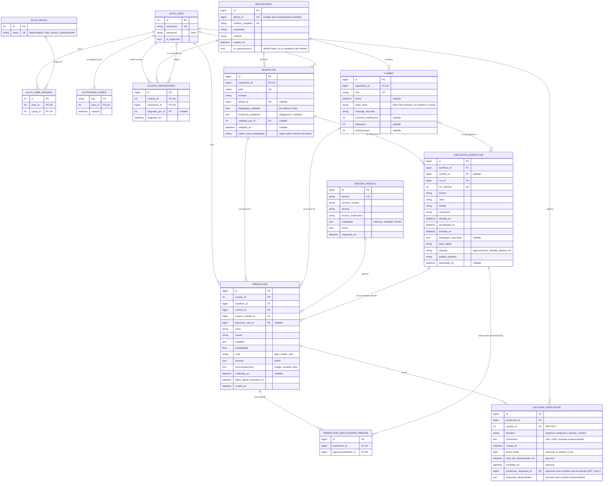

# Arquitectura

## Visión general

## Modelo de datos (PostgreSQL)

Nombres de tabla de Django: `riesgo_<modelo>` para la aplicación y `auth_*` / `authtoken_token` para usuarios, roles y tokens. PK = clave primaria, FK = clave foránea, UK = participa en una restricción de unicidad.

Las métricas del cambio (`archivos_modificados`, `adiciones`, `eliminaciones`) se guardan para trazabilidad y supervisión; **no son variables del modelo v1.1**, que se entrenó sin ellas porque GHALogs no las contiene. `DECISION_DESPLIEGUE` es un registro de auditoría: cada decisión es una fila nueva y `decision` y `comentario` no se editan; la vigente es la más reciente. Solo `fecha_limite` (líder o administrador) y las marcas `vista_por_desarrollador_en` y `cumplida_en` (solo el desarrollador dueño de la predicción) cambian después, y únicamente en la última decisión; en el admin de Django son de solo lectura.

### Restricciones de unicidad

| Tabla | Única por |
|---|---|
| `REPOSITORIO` | `nombre_completo`; `github_id` |
| `ACCESO_REPOSITORIO` | (`usuario_id`, `repositorio_id`) |
| `WORKFLOW` | (`repositorio_id`, `path`); `github_id` |
| `COMMIT` | (`repositorio_id`, `sha`) |
| `EJECUCION_WORKFLOW` | (`run_id`, `run_attempt`): cada intento es una fila |
| `VERSION_MODELO` | `version` |
| `PREDICCION_EJECUCIONES_PREVIAS` | (`prediccion_id`, `ejecucionworkflow_id`) |

### Reglas de integridad que la base de datos no puede expresar (validadas en `Model.clean()`)

- `WORKFLOW`: si `despliegue_validado = True`, `evidencia_validacion` no puede estar vacía.
- `PREDICCION.commit` debe pertenecer al mismo repositorio que `PREDICCION.workflow`.
- `PREDICCION.ejecucion_real` debe ser del **mismo workflow y del mismo commit**, y haber **empezado después** de `creada_en`.

### Borrado

Las FK hacia `REPOSITORIO`, `WORKFLOW`, `COMMIT`, `VERSION_MODELO` y `EJECUCION_WORKFLOW` usan `PROTECT`: no se puede borrar un elemento referenciado por una predicción, para conservar la trazabilidad. `ACCESO_REPOSITORIO` usa `CASCADE`, porque si se borra el usuario o el repositorio desaparece el acceso. `DECISION_DESPLIEGUE` usa `CASCADE` hacia la predicción y `PROTECT` hacia el usuario que decidió.

## Flujo de una predicción

1. El usuario elige un repositorio con acceso asignado y uno de sus workflows validados (`GET /api/repositorios/`).
2. El backend valida las entradas y busca el repositorio por nombre. Si no lo encuentra, consulta GitHub y lo busca por `github_id`, por si fue renombrado. Después comprueba el **acceso** y que el workflow esté **validado**.
3. Consulta GitHub (commit, historial del workflow e historial del repositorio) y calcula las mismas variables del entrenamiento, usando solo ejecuciones completadas antes del momento de la predicción.
4. Calcula la probabilidad calibrada, el nivel de riesgo, los factores SHAP y las recomendaciones con su código de regla.
5. En una transacción guarda el `COMMIT`, las `EJECUCION_WORKFLOW` previas (enlazadas en `PREDICCION_EJECUCIONES_PREVIAS`) y la `PREDICCION`.

## Verificación del resultado real

`POST /api/predicciones/{id}/verificar/` busca la primera ejecución **completada** del mismo workflow y commit **iniciada después** de la predicción. Después consulta la API de jobs de ese intento y aplica la regla de [fase2_variable_objetivo.md](../informes/fase2_variable_objetivo.md) (sección 6). Guarda `paso_fallido`, `etiqueta` y `subtipo_etiqueta` en `EJECUCION_WORKFLOW` y enlaza `PREDICCION.ejecucion_real`. Si todavía no existe esa ejecución, responde `"estado": "pendiente"`.

## Perfiles de la interfaz por rol

La interfaz separa los perfiles por menú y por los datos o bloques del panel; el diseño (layout, tarjetas, gráficos y colores) es el mismo para todos (`Panel.jsx` con `perfil`). Todos los paneles conservan el dashboard principal (flujo de la plataforma, distribución por nivel, análisis por día, seguimiento de resultados y tendencia), calculado con los análisis que ve cada rol, y debajo añaden sus bloques propios. Si un usuario tiene varios roles se usa el de mayor jerarquía (administrador > líder técnico > desarrollador; el superusuario es administrador), igual que `permissions.rol_principal`. La vista inicial es el panel del rol y una vista que no existe para el rol vuelve a él. Definición: `frontend/src/roles.js`. El pie de página no muestra el modelo activo.

| Rol | Menú | Bloques propios del panel (además del dashboard común) |
|---|---|---|
| Desarrollador | Mi panel · Nuevo análisis · Mi historial | Sus análisis, sus repositorios asignados (`?todos=1`), sus resultados verificados y la tarjeta "Mis asignaciones"; campana con contador y aviso al entrar |
| Líder técnico | Panel del equipo · Pendientes de decisión · Historial del equipo · Nuevo análisis | Riesgo alto por repositorio asignado, análisis por desarrollador, predicciones sin decisión; Pendientes y el historial muestran la fecha límite y si el desarrollador la vio o la cumplió |
| Administrador | Panel de administración · Usuarios y accesos · Workflows · Modelos · Integraciones | Usuarios por rol y workflows (`/api/resumen-admin/`), estado de GitHub, modelo activo y supervisión. "Usuarios y accesos" y "Workflows" abren `/admin/` de Django en la misma pestaña |

Lo que ve cada rol lo decide la asignación de repositorios (`ACCESO_REPOSITORIO`): el líder ve los análisis de todos los desarrolladores asignados a sus repositorios; el desarrollador, solo los suyos.

### Fecha límite y alarma del desarrollador

El líder técnico (o el administrador) puede fijar una fecha límite al decidir, o añadirla o cambiarla después. El comentario de la decisión es el mensaje que recibe el desarrollador. Una predicción puede tener varias decisiones: **la fecha límite y las marcas valen solo para la última**. Una *asignación* es la última decisión de una predicción con `fecha_limite`; su estado se calcula al consultar, con días locales de `America/Guayaquil` (`timezone.localdate()`): **cumplida** (tiene `cumplida_en`), **vencida** (faltan menos de 0 días), **por vencer** (faltan 0 o 1) o **pendiente**. Cambiar la fecha vuelve a dejar la asignación como no vista.

La alarma funciona dentro de la aplicación: consulta `/api/asignaciones/` cada 60 s y al volver a la pestaña, muestra una campana con contador, un aviso al entrar con la asignación más próxima y recordatorios ("vence mañana", "vence hoy", "vencida"). Si el usuario lo permite tras pulsar un botón, usa notificaciones del navegador para asignaciones nuevas o por vencer. El correo es opcional y está desactivado por defecto (`CORREO_ASIGNACIONES=1`; sin `EMAIL_HOST` se usa el backend de consola).

### Respuesta del desarrollador a una asignación

Al entrar a su perfil, el desarrollador con asignaciones pendientes ve una ventana emergente accesible (`role="dialog"`, `aria-modal`, foco atrapado, Escape = "Más tarde") con el mensaje, el tipo de decisión y la fecha límite; las asignaciones mostradas quedan como vistas y la ventana vuelve a salir en el siguiente ingreso mientras sigan pendientes. Con "Posponer" o "Solicitar revisión", **Atender ahora** abre el análisis original y **Realizar nuevo análisis** lleva a Nuevo análisis con el repositorio y el workflow elegidos. Ese análisis se envía con `atiende_decision`; el backend valida que la decisión sea la última de un análisis del mismo usuario y del mismo workflow, de tipo posponer o revisión, y no atendida antes, y al crear la predicción la enlaza (`prediccion_respuesta`, `respuesta_desarrollador`) y la marca cumplida. Con "Autorizar" basta **Entendido**. El líder ve "Cumplida con el análisis #N", el nivel anterior frente al nuevo y el comentario. La marca manual de cumplida se conserva para casos sin nuevo análisis.

### Coherencia de la sesión

El token se guarda en `sessionStorage` (uno por pestaña). Al recuperar el foco y ante el evento `storage`, la interfaz vuelve a consultar `/api/yo/` y, si el usuario o el rol ya no coinciden con lo mostrado, reinicia la vista (`frontend/src/sesion.js`). `Panel` no tiene perfil por defecto: sin un perfil válido no se dibuja, en lugar de caer al panel de administración. Las tarjetas del panel de administración cargan por separado (`Promise.allSettled`, `frontend/src/cargaAdmin.js`) y distinguen datos, vacío y error con su motivo (sin permiso, sesión caducada, servidor sin respuesta).

### Limitaciones conocidas

- **La alarma solo avisa con la aplicación abierta.** Sin correo configurado ni notificaciones push, no hay aviso con la aplicación cerrada.
- **No hay fecha de última sincronización por repositorio**: `/api/integraciones/` solo informa la última extracción global.
- **Acceso desde otra máquina**: el proxy de Vite funciona desde `localhost`; desde otra dirección hace falta añadirla a `DJANGO_ALLOWED_HOSTS`, `CSRF_TRUSTED_ORIGINS` y `CORS_ALLOWED_ORIGINS`.

## Roles y permisos

| Acción | Desarrollador | Líder técnico | Administrador |
|---|:-:|:-:|:-:|
| Ver repositorios | Solo asignados | Solo asignados | Todos |
| Crear análisis | En repositorios asignados | En repositorios asignados | En todos |
| Ver predicciones | Las propias de repositorios asignados | Todas las de repositorios asignados | Todas |
| Verificar el resultado real | Las que puede ver | Las que puede ver | Todas |
| Ver versiones del modelo y métricas | ✔ | ✔ | ✔ |
| Registrar la decisión de despliegue | | En predicciones visibles | ✔ |
| Ver la decisión registrada | Las que puede ver | Las que puede ver | Todas |
| Supervisar el modelo con resultados reales | | | ✔ |
| Ver el estado de la integración con GitHub y sincronizar | | | ✔ |
| Activar una versión del modelo | | | ✔ |
| Asignar accesos y validar workflows (admin de Django) | | | ✔ |
| Fijar o cambiar la fecha límite de una decisión | | En predicciones visibles | ✔ |
| Ver asignaciones con fecha límite | Las de sus análisis | Las de sus repositorios | Todas |
| Marcar una asignación como vista o cumplida | Solo las de sus análisis | | |
| Ver el resumen de usuarios por rol y workflows | | | ✔ |

Al quitar un acceso, el usuario deja de ver ese repositorio y sus predicciones.

## API

| Método | Ruta | Descripción |
|---|---|---|
| POST | `/api/auth/token/` | Obtiene el token con usuario y contraseña |
| GET | `/api/yo/` | Usuario y roles |
| GET | `/api/repositorios/` | Repositorios visibles con algún workflow validado y disponible (selector de Nuevo análisis). Con `?todos=1`: todos los repositorios visibles, con `workflows_validados` (paneles por rol) |
| POST | `/api/predicciones/` | Nueva predicción. Opcional: `atiende_decision` y `respuesta_desarrollador` para responder a una asignación. Errores con `codigo`: `repositorio_no_registrado`, `sin_acceso`, `workflow_no_validado`, `github_*`, `sin_modelo`, `asignacion_no_encontrada`, `asignacion_no_vigente`, `asignacion_no_atendible`, `asignacion_ya_atendida`, `asignacion_otro_workflow` |
| GET | `/api/predicciones/` | Historial visible (`?repositorio=`) |
| GET | `/api/predicciones/{id}/` | Detalle con historial usado y resultado real |
| POST | `/api/predicciones/{id}/verificar/` | Enlaza y etiqueta la ejecución real posterior |
| GET | `/api/modelos/` | Versiones del modelo |
| POST | `/api/predicciones/{id}/decision/` | Registra autorizar / posponer / solicitar revisión, con `fecha_limite` opcional no anterior a hoy (líder técnico o administrador con acceso al repositorio) |
| POST | `/api/predicciones/{id}/fecha-limite/` | Añade o cambia la fecha límite de la última decisión (400 `sin_decision` si no hay ninguna) |
| GET | `/api/asignaciones/` | Últimas decisiones con fecha límite de las predicciones visibles: mensaje, fecha, repositorio, estado, `dias_restantes` y si fue vista |
| POST | `/api/asignaciones/{id}/vista/` y `/cumplida/` | Marca la asignación (solo el desarrollador dueño de la predicción; si no, 403) |
| POST | `/api/asignaciones/{id}/entendida/` | "Entendido" de una autorización (solo el dueño; 400 `no_es_autorizacion` para otras decisiones) |
| GET | `/api/resumen-admin/` | Conteos sin datos personales: usuarios por rol principal (suman el total) y workflows validados, sin validar y disponibles en GitHub (administrador) |
| POST | `/api/modelos/{id}/activar/` | Activa una versión (administrador) |
| GET | `/api/modelos/{id}/supervision/` | Tasa observada de no completados por nivel y Brier sobre predicciones verificadas, y `predicciones_demostracion` (administrador) |
| GET | `/api/integraciones/` | Estado de la API de GitHub (cuota, token configurado sí/no) y volumen almacenado (administrador) |
| POST | `/api/repositorios/{id}/sincronizar/` | Recopila ejecuciones completadas de los workflows validados (administrador) |

## Interfaz: pantalla → elemento → tabla.campo

Cada dato visible viene de la API y, por ella, de la base de datos. Prefijo de tablas: `riesgo_` (por ejemplo, `prediccion` = `riesgo_prediccion`). Los textos marcados como *presentación* son rótulos fijos de la interfaz, no datos.

| Pantalla | Elemento (HTML) | Endpoint | tabla.campo |
|---|---|---|---|
| Todas | Barra lateral: usuario, rol principal y menú del rol | `GET /api/yo/` | `auth_user.username`; `auth_group.name` (vía `auth_user_groups`); `is_superuser` cuenta como administrador |
| Desarrollador | Campana, aviso y tarjeta "Mis asignaciones" | `GET /api/asignaciones/`, `POST /api/asignaciones/{id}/vista|cumplida/` | Última `decisiondespliegue` con `fecha_limite`: `comentario`, `fecha_limite`, `vista_por_desarrollador_en`, `cumplida_en`; `repositorio.nombre_completo` |
| Líder técnico | Pendientes de decisión | `GET /api/predicciones/`, `GET /api/asignaciones/` | Predicciones sin `decisiondespliegue`; asignaciones con su seguimiento |
| Iniciar sesión | `<form>` usuario y contraseña | `POST /api/auth/token/` | `auth_user.username`, `auth_user.password` (hash) → `authtoken_token.key` |
| Nuevo análisis | `<select>` Repositorio | `GET /api/repositorios/` | `repositorio.nombre_completo`, filtrado por `accesorepositorio.usuario_id` (el admin ve todos) |
| Nuevo análisis | `<select>` Workflow de despliegue | `GET /api/repositorios/` | `workflow.path` donde `workflow.despliegue_validado = true` |
| Nuevo análisis | `<fieldset>` Contexto: rama, commit, evento | `POST /api/predicciones/` | se guardan en `prediccion.rama`, `commit.sha` y `prediccion.evento`. Las opciones de evento son *presentación* y repiten las de `SolicitudPrediccionSerializer.EVENTOS` |
| Resultado | Encabezado: repositorio, workflow, commit, rama, evento | respuesta de la predicción | `repositorio.nombre_completo`, `workflow.path`, `commit.sha`, `prediccion.rama`, `prediccion.evento` |
| Resultado | `<dl>` Nivel de riesgo (texto + color) | ídem | `prediccion.nivel` |
| Resultado | `<output>` Probabilidad calibrada | ídem | `prediccion.probabilidad` |
| Resultado | "En la evaluación, falló el X %…" | `GET /api/modelos/` | `versionmodelo.metadatos.tasa_fallos_por_nivel[nivel]` (`tasa`, `n`). **Aún no existe en v1 ni v1.1**; mientras falte, la pantalla dice que no está registrado |
| Resultado | Límites de los niveles | `GET /api/modelos/` | `versionmodelo.metadatos.limites_riesgo` (`medio`, `alto`) |
| Resultado | `<figure>` Factores SHAP | respuesta de la predicción | `prediccion.factores[]` (`variable`, `descripcion`, `valor`, `contribucion`, `efecto`) |
| Resultado | `<ul>` Recomendaciones con código | ídem | `prediccion.recomendaciones[]` (`codigo`, `texto`) |
| Resultado | Resultado real | `POST /api/predicciones/{id}/verificar/` | `ejecucionworkflow.etiqueta`, `subtipo_etiqueta`, `run_id`, `run_attempt`, `iniciada_en`, `conclusion`, `paso_fallido` (vía `prediccion.ejecucion_real_id`). Los rótulos de los códigos son *presentación* |
| Resultado | "Cambio del commit" | respuesta de la predicción | `commit.archivos_modificados`, `commit.adiciones`, `commit.eliminaciones` |
| Resultado | `<ol>` Decisiones registradas | ídem | `decisiondespliegue.decision`, `comentario`, `creada_en`; `auth_user.username` |
| Resultado | `<form>` Registrar decisión con fecha límite opcional (líder técnico y administrador) | `POST /api/predicciones/{id}/decision/` | nueva fila en `decisiondespliegue` (`fecha_limite`) |
| Resultado | `<form>` Añadir o cambiar la fecha límite | `POST /api/predicciones/{id}/fecha-limite/` | `decisiondespliegue.fecha_limite` de la última decisión |
| Resultado | `<footer>` trazabilidad | respuesta de la predicción | `versionmodelo.version`; número de filas de `prediccion_ejecuciones_previas`; `prediccion.datos_github_extraidos_en`; `auth_user.username`; `prediccion.creada_en` |
| Historial | `<table>` | `GET /api/predicciones/` | `prediccion.creada_en`, `repositorio.nombre_completo`, `workflow.path`, `commit.sha`, `prediccion.nivel`, `prediccion.probabilidad`, `ejecucionworkflow.etiqueta`, la `decisiondespliegue.decision` más reciente, `auth_user.username` |
| Mi panel / Panel del equipo | Filtro de período y "datos cargados" | — | Filtro aplicado en el navegador sobre `prediccion.creada_en`; la hora es la de la última carga de la API |
| Mi panel / Panel del equipo | KPI "Análisis realizados" (y período anterior) | `GET /api/predicciones/` | `COUNT(prediccion.id)` en el período y en el período anterior de igual duración |
| Mi panel / Panel del equipo | KPI "Riesgo Alto" | ídem | `COUNT` con `prediccion.nivel = 'alto'` y su porcentaje |
| Mi panel / Panel del equipo | KPI "Probabilidad media" | ídem | `AVG(prediccion.probabilidad)` |
| Mi panel / Panel del equipo | KPI "Resultados verificados" | ídem | predicciones con `prediccion.ejecucion_real_id`; evaluables = `ejecucionworkflow.etiqueta` con y definido; no completados = y = 1 |
| Panel de administración | KPI "Modelo activo" | `GET /api/modelos/` | `versionmodelo.version`, `nombre_modelo`, `metadatos.metricas_prueba["PR-AUC"]` |
| Mi panel | Embudo "Mis resultados verificados" | ídem | Total → con `ejecucion_real` → con y definido → y = 1 |
| Mi panel / Panel del equipo | `<table>` Mis repositorios / Riesgo alto por repositorio (`?todos=1`) | ídem | Por `repositorio.nombre_completo`: `COUNT`, `COUNT(nivel='alto')`, `AVG(probabilidad)`, `MAX(creada_en)`; el nivel de la media usa `versionmodelo.metadatos.limites_riesgo` |
| Mi panel / Panel del equipo | Mis análisis recientes / Predicciones sin decisión | ídem | Las 6 `prediccion` más recientes: `repositorio`, `workflow.path`, `creada_en`, `nivel` |
| Modelos | `<table>` | `GET /api/modelos/` | `versionmodelo.version`, `nombre_modelo`, `activo`, `registrado_en`; `metadatos.filas_entrenamiento`, `metadatos.filas_prueba`, `metadatos.metricas_prueba` (PR-AUC, ROC-AUC, Precision, Recall, F1, Brier), `metadatos.limites_riesgo` |
| Modelos | `<button>` Activar (solo administrador) | `POST /api/modelos/{id}/activar/` | `versionmodelo.activo` |
| Modelos | `<table>` Supervisión (solo administrador) | `GET /api/modelos/{id}/supervision/` | Por `prediccion.version_modelo_id`: `COUNT`; con `ejecucion_real_id`; evaluables; por `prediccion.nivel`, `SUM(y)/COUNT`; Brier = media de (`probabilidad` − y)² |
| Panel de administración | "Estado de GitHub" | `GET /api/integraciones/` | `settings.GITHUB_API_URL`; `GITHUB_TOKEN` solo como sí/no; `/rate_limit` de GitHub; `COUNT` de `repositorio`, `workflow` validados y `ejecucionworkflow`; `MAX(ejecucionworkflow.extraida_en)` |
| Integraciones | `<table>` Sincronizar por repositorio | `GET /api/repositorios/`, `POST /api/repositorios/{id}/sincronizar/` | Inserta o actualiza `ejecucionworkflow` (y `commit`) por (`run_id`, `run_attempt`) |

## Seguridad

- Secretos solo en `backend/.env` (ignorado por git); `SECRET_KEY` es obligatoria fuera de modo de depuración.
- Token de GitHub de solo lectura. Un repositorio privado sin acceso responde igual que uno inexistente (404).
- Control de acceso por repositorio (`ACCESO_REPOSITORIO`) además del rol.
- El filtro `OcultarSecretos` elimina tokens de los registros.
- Autenticación por token, permisos por rol y límite de 120 solicitudes por hora por usuario.
- De los autores de commits solo se guarda un hash; nunca nombres ni correos.
